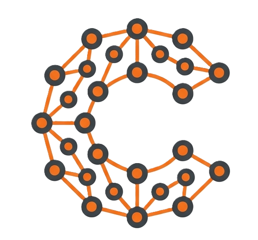
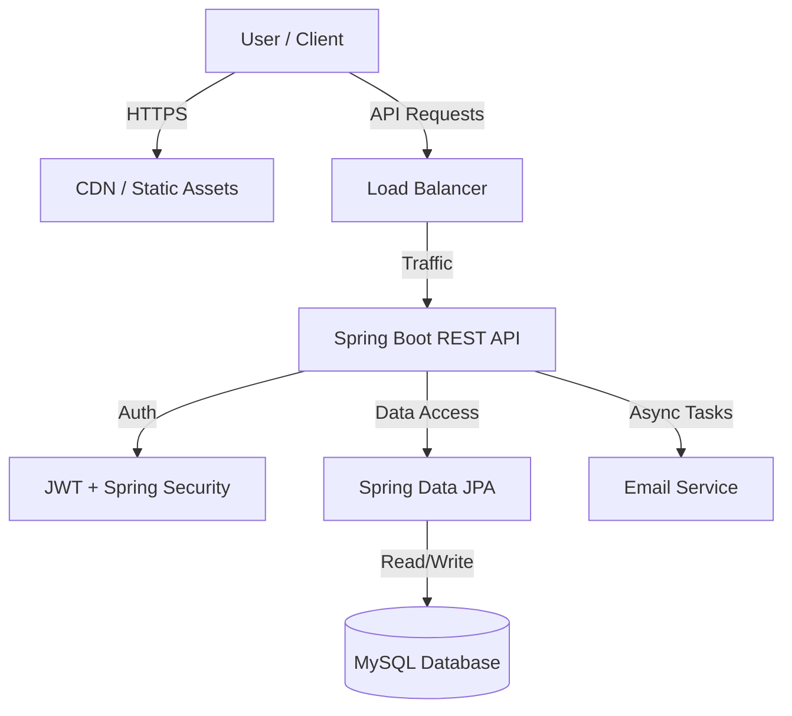
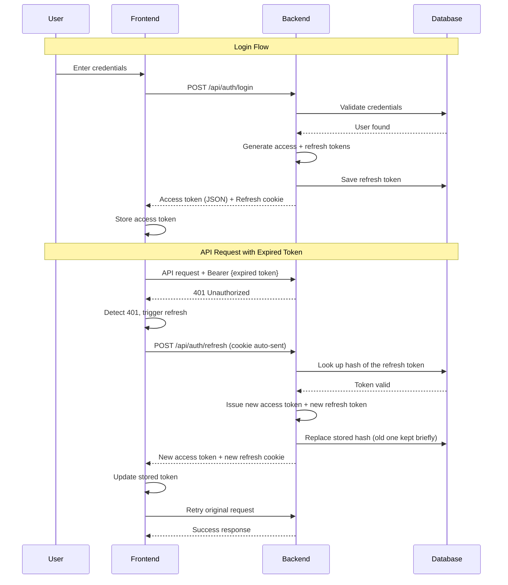
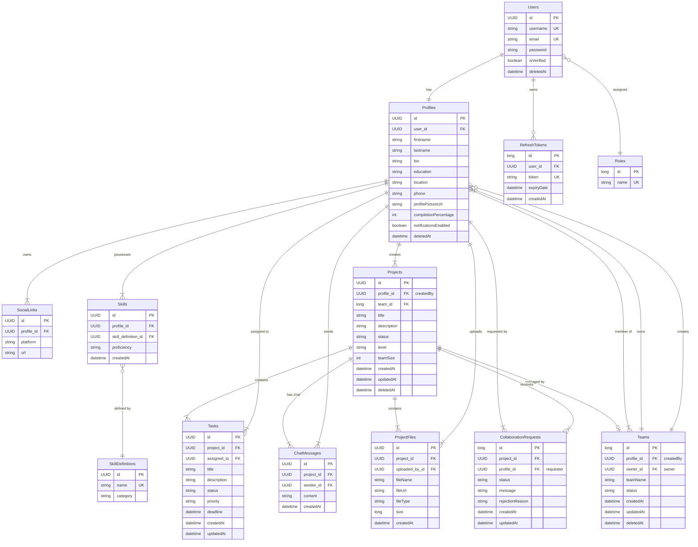

<p align="center">
  
</p>

# Collabro 🚀

> **Connect. Collaborate. Create.**  
> A comprehensive platform designed to bridge the gap between developers, designers, and creators, enabling seamless team formation and project collaboration.


---

## 📖 Table of Contents

- [Idea & Scope](#-idea--scope)
- [System Design](#-system-design)
- [Database Architecture](#-database-architecture)
- [Core Features](#-core-features)
- [Tech Stack](#-tech-stack)
- [Getting Started](#-getting-started)
- [Future Roadmap](#-future-roadmap)

---

## 💡 Idea & Scope

**Collabro** serves as a specialized networking ecosystem where individuals can showcase their skills, find specific projects that match their interests, and form teams. Unlike generic social networks, Collabro focuses on **skill-based matching** and **project lifecycle management**.

### Application Scope

The current implementation covers:

1.  **User Identity**: Secure authentication, profile building, and a skills portfolio.
2.  **Project Marketplace**: Users post project ideas, browse them with filters, and send join requests.
3.  **Teams**: A project's team is created automatically when its owner approves the first join request. Members can leave; owners can remove members or delete the project.
4.  **Collaboration Tools**: Tasks with assignees and deadlines, per-project chat, and file sharing, all limited to the project's team.
5.  **Activity**: A timeline of your projects, requests, collaborations, tasks and uploads (computed from existing data), and badges that unlock as you take part.

---

## 🏗 System Design

Collabro follows a robust **Monolithic Architecture** (migratable to Microservices) with a clear separation of concerns between the Client and Server.

- **Frontend**: A Single Page Application (SPA) built with React and Vite, optimized for performance and responsiveness.
- **Backend**: A RESTful API service developed with Spring Boot, handling business logic, security, and data persistence.
- **Database**: Relational data model using MySQL for structured data integrity.

### High-Level Architecture



### 🔐 Authentication Architecture

Collabro employs a robust **Stateless Authentication** system designed for security and scalability, minimizing database load while ensuring session persistence.

#### Token Strategy

| Token Type        | Lifespan   | Storage                                   | Purpose                                  |
| ----------------- | ---------- | ----------------------------------------- | ---------------------------------------- |
| **Access Token**  | 15 minutes | Memory + localStorage (browser)           | API authentication (`Bearer` header)     |
| **Refresh Token** | 7 days     | HTTP-only cookie; SHA-256 hash in the DB  | Obtain a new access token (single use)   |

Both are signed JWTs carrying a `type` claim, so a refresh token is rejected when presented as an access token.

#### Authentication Flow

The following sequence diagram illustrates the complete login and automatic token refresh process:



#### Security Features

- **HTTP-only refresh cookie**: unreachable from JavaScript. `Secure` and `SameSite` come from configuration.
- **Refresh token rotation**: every refresh swaps in a new token. Replaying an already-used token (outside a 10-second grace window for concurrent tabs) ends the session.
- **Hashed at rest**: only a SHA-256 hash of the refresh token is stored.
- **One-time codes**: 6-digit OTPs expire after 10 minutes, are burned after 5 wrong guesses, are limited to one per minute per address, and cannot be used for a different purpose than they were issued for.
- **Sessions end on password change**: resetting or changing a password signs the user out everywhere else.
- **Single refresh in flight**: the frontend shares one refresh between concurrent requests and never retries a request twice.

---

## 💾 Database Architecture

The database is designed to handle complex relationships between users, teams, and projects. Below is the Entity Relationship (ER) Diagram representing the core schema.

### ER Diagram



---

## ✨ Core Features

### 🔐 Authentication & Security

- **Registration and login** with short-lived JWT access tokens and rotating refresh tokens.
- **Email verification** and **password reset** using one-time codes.
- **Change password** and **delete account** (both re-check the current password).
- **Role-based access**: `ROLE_USER` and a reserved `ROLE_ADMIN` (no admin features yet).

### 👤 Profile Management

- **Skills** with proficiency levels, **social links** (http/https only), **profile completeness**.
- **Profile picture** upload (PNG, JPEG, GIF, WebP up to 5 MB, verified by content, not just extension).
- **PDF export** of a completed profile.
- **Settings**: notification and team preferences, change password, delete account.

### 🚀 Projects, Teams & Collaboration

- **Projects**: detailed specs, edit, delete (owner), filter/sort/search when browsing.
- **Join requests**: apply with a message; the owner approves or rejects; you can re-apply after a rejection or after leaving.
- **Teams**: created on the first approval. **My Teams** lists teams you own or belong to; members can leave, owners can remove members.
- **Tasks, chat and files**: visible and editable only by the owner and team members; files are served as downloads.

### 📈 Activity & Achievements

- **History**: a filterable timeline of your projects, requests, collaborations, completed tasks and uploads.
- **Achievements**: 14 badges (projects, collaborations, leadership, skills, activity) with progress, points, levels and ranks, computed from your activity.

### 🤝 Networking

- **Profile search** (public, contact details never included) by skill, minimum proficiency, location and education.
- **Suggestions**: people with similar skills, and people with skills you lack.

---

## 🛠 Tech Stack

### Frontend (Client)

| Tech             | Description                                    |
| :--------------- | :--------------------------------------------- |
| **React 18**     | UI Library for building interactive interfaces |
| **Vite**         | Next Generation Frontend Tooling               |
| **TypeScript**   | Static typing for better developer experience  |
| **TailwindCSS**  | Utility-first CSS framework for styling        |
| **Lucide React** | Beautiful & consistent icon set                |
| **Axios**        | Promise based HTTP client                      |
| **React Router** | Declarative routing                            |

### Backend (Server)

| Tech                | Description                                  |
| :------------------ | :------------------------------------------- |
| **Java 21**         | Core programming language                    |
| **Spring Boot 3.4** | Framework for building production-ready apps |
| **Spring Security** | Authentication and Access Control            |
| **Spring Data JPA** | Abstraction over JDBC/Hibernate              |
| **MySQL**           | Main relational database                     |
| **Lombok**          | Boilerplate code reduction                   |
| **JJWT**            | JWT creation and verification                |

---

## 🚀 Getting Started

Follow these instructions to set up the project locally.

### Prerequisites

- **Node.js** (v18+)
- **Java JDK** (21)
- **MySQL** (Running locally or via Docker)
- **Maven** (Included via wrapper)

### 1. Clone the Repository

```bash
git clone https://github.com/ojasvatstyagi/Collabro.git
cd Collabro
```

### 2. Backend Setup

```bash
cd backend
cp .env.example .env     # then fill it in (it is gitignored)
```

`.env` is loaded automatically. It needs the database and mail credentials and a JWT secret (at least 32 characters, e.g. `openssl rand -hex 32`). The application refuses to start without `JWT_SECRET`. Uploaded files go to `UPLOAD_DIR` (default `./uploads`).

**Run the application** (development profile: `ddl-auto=update`, SQL logging on):

```bash
./mvnw spring-boot:run
```

The server starts on `http://localhost:8080` (API docs at `/swagger-ui.html` in development).

**Run the tests** (they use an in-memory H2 database and need no credentials):

```bash
./mvnw test
```

**Production**: set `SPRING_PROFILES_ACTIVE=prod` and provide every variable in `application-prod.properties` (database, mail, `JWT_SECRET`, `CORS_ALLOWED_ORIGINS`, `UPLOAD_DIR`). That profile validates the schema instead of changing it, hides SQL and the API docs, and sets the refresh cookie `Secure`. The schema must already exist; there is no migration tool yet.

### 3. Frontend Setup

Open a new terminal and navigate to the frontend directory.

```bash
cd frontend
```

**Install Dependencies:**

```bash
npm install
```

**Run Development Server:**

```bash
npm run dev
```

The application will be available at `http://localhost:5173` (it proxies `/api` to the backend on port 8080).

**Checks:** `npm test` (unit tests), `npm run lint`, and `npm run build` (type-checks, then builds).

---

## 🌟 Future Roadmap

- [ ] **Real-time Chat**: WebSocket implementation for team communication.
- [ ] **AI Recommendation Engine**: Analyzing user skills to suggest the perfect team.
- [ ] **CI/CD Integration**: Automated testing and deployment pipelines.
- [ ] **Mobile App**: Native mobile experience using React Native.

---

<p align="center">Made by the Collabro Team</p>
